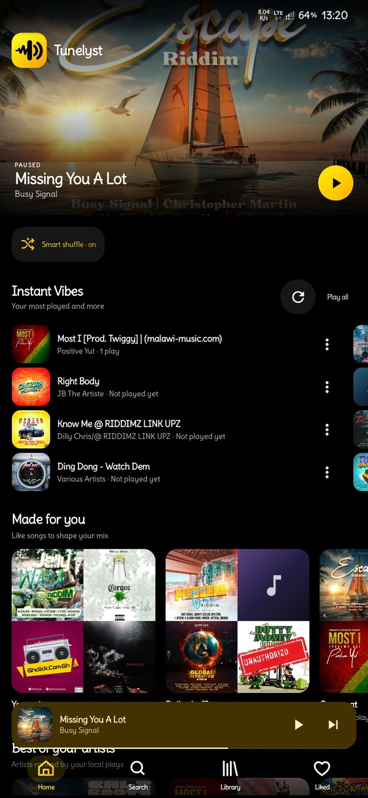
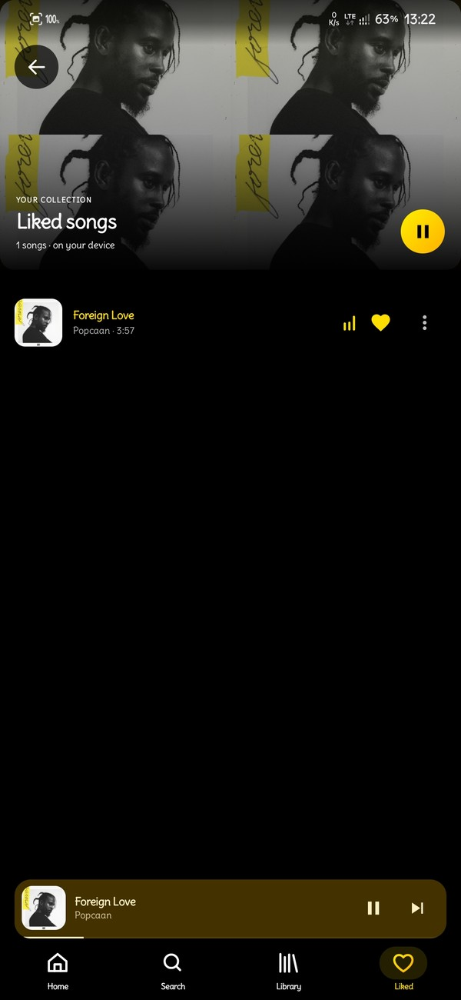
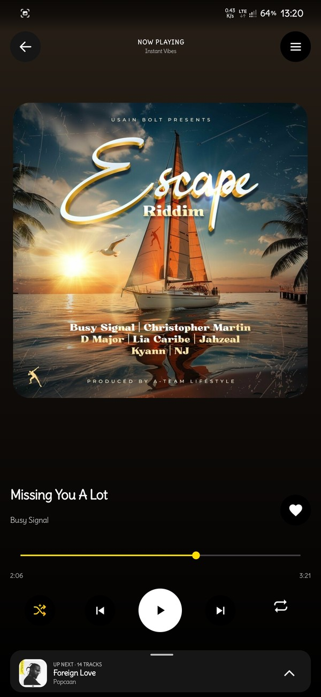
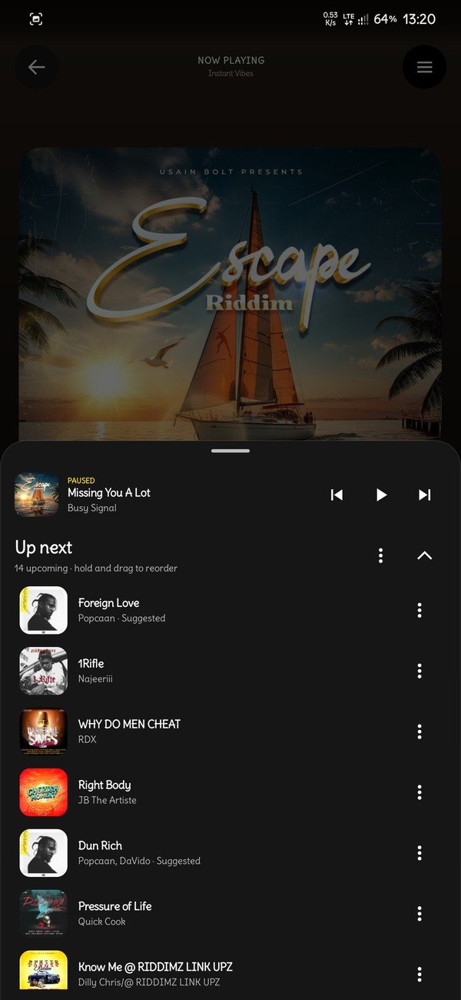

  

<h1 align="center">Tunelyst</h1>

  Your music deserves a beautiful home.

Tunelyst brings the songs on your phone together in one place, making your collection easy to explore and a joy to play.

## A look inside

  
  
  
  

## Your music, your way

- **Explore your collection** by song, album, artist, or folder.
- **Make it yours** with playlists and liked songs.
- **Rediscover your favorites** with Smart Shuffle.
- **Listen at your own pace** with a sleep timer.

## Download

[Download Tunelyst](https://github.com/nyekeza/Tunelyst/releases/latest)

Tunelyst works on Android 10 and later. Download the APK from the release page, open it on your phone, and follow the installation prompts. When you open Tunelyst, allow access to your music.

If Android won't update an older copy of Tunelyst, it may have been signed with a different key. Removing that copy can erase its local data, so check your playlists and settings first.

## Feedback

Have an idea or found a problem? [Open an issue](https://github.com/nyekeza/Tunelyst/issues). Your feedback is welcome.
